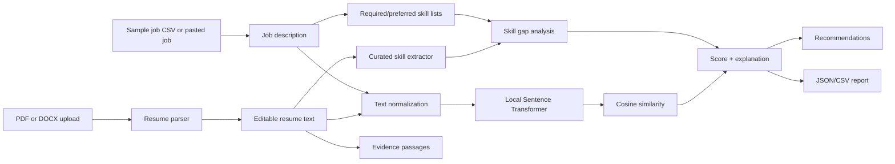

# JobMatch AI — Semantic Resume Matcher

JobMatch AI is a zero-budget portfolio project that helps a candidate understand how a resume aligns with a job description. It combines local Sentence Transformer embeddings, cosine similarity, transparent skill matching, evidence snippets, rule-based recommendations, multi-job ranking, and downloadable reports in a Streamlit interface.

> **Responsible interpretation:** the similarity score is a relative semantic similarity measure. It is not hiring probability, a qualification decision, or a statistically calibrated measure of candidate suitability. A skill that is not detected may still be present if the resume wording or curated dictionary does not cover it.

## Why this is a useful portfolio project

The project demonstrates a complete applied NLP workflow without a paid API: document parsing, preprocessing, embedding generation, vector similarity, information extraction, explainability, error handling, evaluation, testing, and deployment preparation. It is intentionally modular so an undergraduate developer can explain each part during an interview.

## Features

- Upload PDF or DOCX resumes.
- Parse text in memory and let the user edit it before analysis.
- Paste a job description or choose from 32 clearly labeled synthetic sample jobs.
- Compute a 0–100 semantic similarity display score with `sentence-transformers/all-MiniLM-L6-v2`.
- Use an explainable lexical fallback when the local model cannot be downloaded.
- Detect curated skills with aliases and word-boundary checks.
- Separate required-skill gaps from preferred-skill gaps.
- Show relevant resume passages and evidence-based match explanations.
- Rank the full sample dataset and filter it by role category.
- Generate practical, non-fabricating improvement suggestions without an LLM API.
- Export a privacy-conscious JSON or CSV report; the original resume is excluded by default.
- Include unit tests for parsing, similarity, skills, ranking, and report generation.
- Include a small manually reviewed evaluation set and an evaluation runner.

## Technology stack

- Python 3.11+ (tested here with Python 3.12)
- Streamlit
- Sentence Transformers with `all-MiniLM-L6-v2`
- NumPy and scikit-learn-compatible cosine mathematics
- Pandas
- PyMuPDF for PDFs
- python-docx for DOCX files
- Plotly for ranking charts
- pytest
- CSV/JSON instead of a database

No LangChain, vector database, paid API, API key, or external LLM is required.

## Project structure

```text
jobmatch-ai/
├── app.py
├── requirements.txt
├── README.md
├── LICENSE
├── pyproject.toml
├── data/
│   ├── sample_jobs.csv
│   └── README.md
├── src/
│   ├── embeddings.py
│   ├── job_ranker.py
│   ├── recommendations.py
│   ├── report_generator.py
│   ├── resume_parser.py
│   ├── similarity.py
│   ├── skills_extractor.py
│   └── text_preprocessing.py
├── tests/
│   ├── test_job_ranker.py
│   ├── test_report_generator.py
│   ├── test_resume_parser.py
│   ├── test_similarity.py
│   └── test_skills_extractor.py
├── evaluation/
│   ├── evaluation_data.csv
│   └── evaluation_report.md
├── scripts/
│   ├── check_syntax.py
│   └── run_evaluation.py
├── screenshots/
│   └── README.md
└── .streamlit/config.toml
```

## Architecture and workflow



### How the important modules work

1. **`resume_parser.py`** reads PDF and DOCX bytes in memory. It rejects unsupported, empty, password-protected, invalid, or textless files with a clear error.
2. **`text_preprocessing.py`** normalizes Unicode, whitespace, and basic tokens without destroying useful punctuation.
3. **`embeddings.py`** loads the local model lazily and only once per process. If it is unavailable, the app uses a deterministic token-overlap fallback and labels the result.
4. **`similarity.py`** calculates cosine similarity and scales `[-1, 1]` to `[0, 100]` using `(cosine + 1) × 50`. This is a display transformation, not calibration.
5. **`skills_extractor.py`** maps aliases such as `sklearn` to `scikit-learn` and uses regex lookarounds so `Java` does not match inside `JavaScript`.
6. **`job_ranker.py`** analyzes each job, counts required-skill coverage, and sorts by semantic score followed by detected required skills.
7. **`recommendations.py`** produces rules-based suggestions. It never invents a project, certification, achievement, or experience.
8. **`report_generator.py`** builds JSON and CSV downloads. The original resume text is opt-in.
9. **`app.py`** connects these pieces into the upload, analysis, explorer, comparison, and methodology tabs.

## Run locally on Linux/macOS

```bash
git clone <your-github-repository-url>
cd jobmatch-ai
python3 -m venv .venv
source .venv/bin/activate
python -m pip install --upgrade pip
python -m pip install -r requirements.txt
streamlit run app.py
```

Open the local URL printed by Streamlit, normally `http://localhost:8501`.

## Run locally on Windows PowerShell

```powershell
git clone <your-github-repository-url>
cd jobmatch-ai
py -3.11 -m venv .venv
.\.venv\Scripts\Activate.ps1
python -m pip install --upgrade pip
python -m pip install -r requirements.txt
streamlit run app.py
```

The first semantic analysis downloads the model from Hugging Face. That download can take time and requires network access. After the model is cached, normal local use does not need a paid service or API key.

## Test and evaluate

Run the syntax check and unit tests from the repository root:

```bash
python scripts/check_syntax.py
pytest
```

Run the small manually reviewed evaluation set:

```bash
python scripts/run_evaluation.py
```

The runner updates `evaluation/evaluation_report.md` with the observed scoring method, pair scores, and a simple high-vs-low ordering check. The evaluation data is synthetic and small; it is a sanity check, not a production benchmark.

## Example usage

1. Start the app and upload a text-based PDF or DOCX resume.
2. Read the extracted text in the editor and correct formatting or extraction errors.
3. Select a synthetic job such as **NLP Research Intern**, or choose **Paste manually**.
4. Click **Analyze resume**.
5. Inspect the score, detected skills, missing required skills, missing preferred skills, evidence passages, and recommendations.
6. Open **Compare all jobs** to rank the resume against the synthetic dataset.
7. Download JSON or CSV when you want a compact record of the analysis.

The sample jobs are synthetic records. They are not current vacancies and do not claim to represent any real employer.

## Dataset provenance

`data/sample_jobs.csv` contains 32 synthetic records across AI Engineering, Machine Learning, Generative AI, Natural Language Processing, Data Science, Python Development, Computer Vision, and Data Analytics. Each record includes required skills, preferred skills, experience level, description, and provenance. No real vacancy is implied.

## Evaluation notes

The reviewed set in `evaluation/evaluation_data.csv` contains nine synthetic resume/job pairs with `high`, `medium`, or `low` labels. Labels are manually reviewed qualitative labels. The evaluation runner looks up each `job_id` in the bundled synthetic dataset and scores the full corresponding job description with the same comparison function used by the app.

Do not report the small result as hiring accuracy, fairness evidence, or a calibrated threshold. For a serious study, use a larger independently reviewed dataset, pre-register the labels and metrics, and evaluate ranking quality with an appropriate protocol.

## Privacy and security

- Uploaded resume bytes are parsed in memory by default and are not written to a project database.
- The app does not log full resume contents.
- Downloaded reports omit the original resume unless the user explicitly checks the inclusion box.
- Do not commit resumes, secrets, `.streamlit/secrets.toml`, or downloaded model artifacts.
- A public deployment still processes user uploads in its hosting environment; review the host's terms and privacy requirements before using real personal data.

## Deployment with Streamlit Community Cloud

1. Push the repository to a GitHub repository.
2. Confirm `requirements.txt` is at the repository root.
3. In Streamlit Community Cloud, choose **Deploy an app**, select the repository and branch, and set the main file to `app.py`.
4. No secrets are required.
5. The first cold start downloads the Sentence Transformer model. If the hosting environment cannot download or retain the model, the app will remain usable with the labeled lexical fallback, but the semantic quality will be lower.
6. Keep the sample dataset small and avoid storing user resumes. For a production system, add explicit retention controls, authentication, rate limits, and a formal privacy review.

A free local deployment is always available with `streamlit run app.py`. The repository intentionally avoids API keys and paid infrastructure.

## GitHub publishing checklist

```bash
git add .
git commit -m "Build JobMatch AI semantic resume matcher"
git branch -M main
git remote add origin https://github.com/<username>/jobmatch-ai.git
git push -u origin main
```

Before pushing, check that no resume, secret, credential, or large model cache is included. Add genuine screenshots of the running app to `screenshots/` if you want the GitHub README to show the interface.

## Known limitations and future improvements

- Image-only PDFs need OCR; this version intentionally reports that no selectable text was found.
- The curated dictionary cannot cover every synonym, abbreviation, language, or domain skill.
- Similarity can be influenced by document length and writing style.
- A semantic match is not a hiring decision and should not be used as an automated rejection rule.
- Manual job descriptions do not automatically infer required/preferred fields; the skills-gap panel is strongest when the job uses recognizable skill labels.
- Future improvements could add OCR as an optional dependency, versioned skill ontologies, sentence-level evidence ranking, human corrections, multilingual models, fairness review, and a larger reviewed evaluation set.

## Beginner interview explanation

**What is an embedding?** It is a numeric representation of text where semantically similar text tends to have nearby vectors. The model does not simply count exact words; it uses a pretrained language model to create a compact representation.

**What is cosine similarity?** It measures the angle between two vectors. If they point in a similar direction, the texts are more similar. JobMatch AI turns the raw value into a friendlier 0–100 display score, but does not pretend that number is calibrated.

**Why keep a skills dictionary?** It makes the gap analysis easy to inspect and debug. A reviewer can see exactly why `sklearn` was mapped to `scikit-learn`. The trade-off is that dictionary matching misses unknown synonyms.

**Why use a fallback?** Model downloads can fail in local or hosted environments. A labeled lexical fallback keeps the interface usable while making the quality difference visible instead of silently failing.

**How would you improve it?** I would create a larger independently reviewed evaluation set, add OCR for scanned resumes, expand the skills ontology, add human correction controls, compare multiple embedding models, and assess fairness before using the system in a consequential workflow.

## Acknowledgements

- Sentence Transformers / Hugging Face model authors for `sentence-transformers/all-MiniLM-L6-v2`.
- PyMuPDF and python-docx for document parsing.
- Streamlit, Pandas, NumPy, Plotly, scikit-learn, and pytest for the open-source tooling used in this project.
